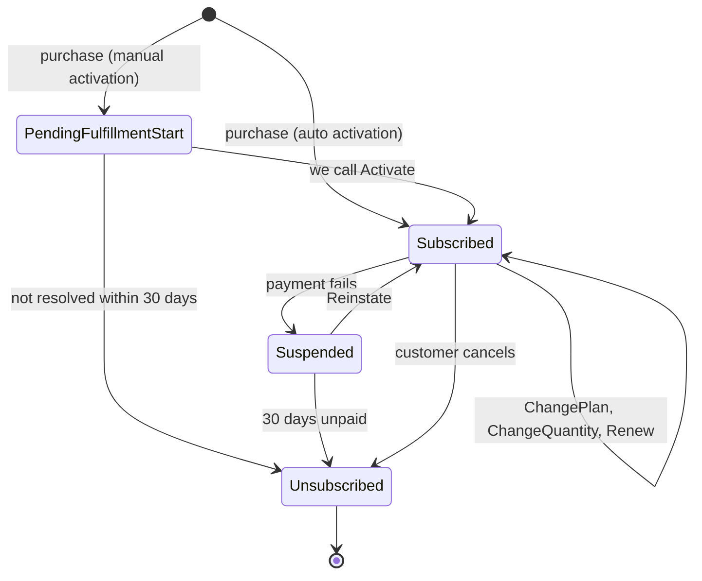
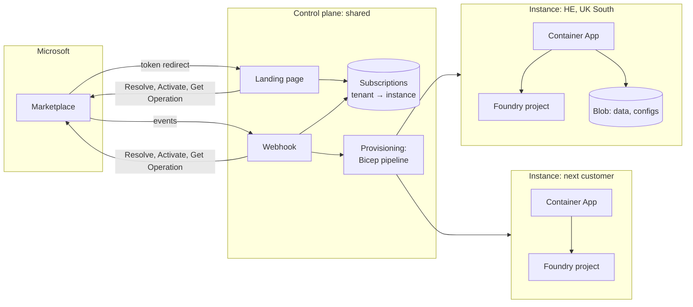

# Selling the decision engine on Microsoft Marketplace

A technical guide to selling the decision engine as a SaaS product through Microsoft Marketplace, including how to connect it to a client's own data. It's a proposal: none of this is built yet. The short version for the wider team is the one-pager, *Selling the decision engine as a product*.

Checked against Microsoft's documentation on 9 November 2026. Marketplace rules change often, so recheck the linked pages before acting on a detail. Numbers in square brackets point to the [sources](#sources) at the end.

## Contents

1. [The decision](#1-the-decision)
2. [Commercial setup](#2-commercial-setup)
3. [How a purchase works](#3-how-a-purchase-works)
4. [Identity and sign-in](#4-identity-and-sign-in)
5. [Changes to the app](#5-changes-to-the-app)
6. [Regions and data residency](#6-regions-and-data-residency)
7. [Connecting to a client's own data](#7-connecting-to-a-clients-own-data)
8. [Charging for model usage](#8-charging-for-model-usage)
9. [Testing before going live](#9-testing-before-going-live)
10. [Work breakdown](#10-work-breakdown)
11. [Open questions](#11-open-questions)
12. [Sources](#sources)

## 1. The decision

Homes England can't take on more technical work, so we sell them the decision engine as a product they subscribe to. Microsoft offers several ways to sell software through Marketplace [1][2]:

| Offer type | Where it runs | What the client owns | Fits HE? |
| --- | --- | --- | --- |
| **SaaS** | Our tenant and subscription | Who can sign in | **Yes** |
| Azure Application: managed application | Client's subscription, in a resource group we can manage [3] | The subscription, its quota, policies and Azure bill | No: they'd still own infrastructure |
| Azure Application: solution template | Client's subscription, no access for us | Everything | No |
| Container | Client's Kubernetes or container platform | The cluster and its operations | No |

Microsoft's own guidance points the same way. It recommends SaaS when the publisher can host the service centrally, and in-tenant offers mainly for data sovereignty or network requirements [1]. Our data is public open data and GOV.UK guidance, so those reasons don't apply.

The consequences of choosing SaaS:

- **The app keeps running in our subscription,** as it does today, one instance per customer.
- **We pay for Foundry,** so the price has to cover model usage (section 8).
- **We must integrate with Marketplace:** a landing page, a webhook, and the SaaS fulfillment APIs (section 3).
- **Sign-in must work for other organisations' Entra tenants** (section 4).

## 2. Commercial setup

### Partner Center account

We publish through Partner Center, which needs a company account enrolled in the Commercial Marketplace programme. If Solirius is already in the Microsoft AI Cloud Partner Program, the existing account can be enrolled from Partner Center by someone with the Owner role [4].

### The offer and its plans

A SaaS offer has one or more plans. Each plan is priced flat-rate, per user, or with metered dimensions on top of a base fee [12]. For HE, a single flat annual plan is the simplest, sold to them through a private offer (below).

The offer's **Technical configuration** page needs four values [5]:

| Field | What it is |
| --- | --- |
| Landing page URL | Where buyers land after purchase, e.g. `https://<our-domain>/marketplace/landing` |
| Connection webhook | Where Microsoft sends subscription events |
| Microsoft Entra tenant ID | Our tenant, which holds the app that calls the fulfillment APIs |
| Microsoft Entra application ID | That app's client ID (section 4) |

Both URLs must be available 24/7 [5]. Neither may contain secrets or a `#` [5].

### Private offers

A private offer gives one customer their own price, contract length, billing schedule and terms [6]:

- **Targeting:** it's created for the customer's Azure billing account and shared as a link. The customer can also find it under private offer management in the Azure portal.
- **Contents:** up to 10 products or plans in one private offer.
- **Single-click purchase** applies to eligible SaaS and professional services products, when the customer has an EA or MCA billing account. Subscriptions then activate automatically, and billing starts at purchase or on a date we set.
- **Billing:** the customer sees the private price in Azure Cost Management and is invoiced by Microsoft.
- **Availability:** private offers are usually live within 15 minutes; private plans can take up to 48 hours.

### Contract terms

There are two routes [7][8]:

- **Microsoft's Standard Contract,** which many customers have already vetted. Universal amendments apply to every customer. Custom amendments target one customer's tenant ID, up to 4,000 characters.
- **Our own terms.** For a private offer, these can be a single PDF of customer-specific terms. They mustn't conflict with the Marketplace Publisher Agreement.

Once an offer is published under the Standard Contract, it can't switch to our own terms [7].

### Azure consumption commitments

If HE has a Microsoft Azure Consumption Commitment (MACC), purchases of "Azure benefit eligible" offers count 100% of their pre-tax amount toward it. That only applies when bought through the Azure portal under the agreement linked to the commitment [9]. It can make the purchase easier to approve, because it spends money HE has already committed. Professional services don't count toward a MACC [10].

### Fees

Microsoft keeps a 3% store service fee on transactable offers [11].

### Selling consulting work alongside the product

Connector work for a client (section 7) can be sold as a **professional service** offer, but only through an ISV-to-customer private offer [10]:

- Both seller and customer must be in the US, UK or Canada. That works for HE but not for a French customer.
- Professional services can't be sold through multiparty private offers [10]. My earlier answer in chat suggested that route; it was wrong.
- Support bundled into the software price must be under 10% of the total [10].

A single-click private offer can hold both the SaaS plan and the professional service [6].

### Procurement route

Before building anything, check that HE can buy through Marketplace at all. UK public bodies usually buy cloud software through G-Cloud. The Government Commercial Agency launched G-Cloud 15 on 10 August 2026 [13], so a G-Cloud listing may be needed as well as, or instead of, Marketplace. The technical work in this guide is mostly the same either way, apart from the Marketplace integration in section 3.

## 3. How a purchase works

Microsoft keeps the subscription state; we keep our side in step with it [14].



### Manual activation

1. The customer buys the offer, then selects **Configure account now** in the Azure portal or the email [14].
2. Microsoft opens our landing page with `?token=<purchase token>` [14].
3. The user signs in with Entra single sign-on [14][15].
4. Our backend calls **Resolve** with the token, which returns the subscription ID, offer, plan and the purchaser's details [14][16].
5. We set up the customer's instance, then call **Activate**. Billing starts only when Activate succeeds [14].

We have 30 days to resolve a pending purchase. After that it's voided and not billed [14].

### Auto activation

Single-click private offers activate automatically [6]. The subscription goes straight to `Subscribed` and billing starts at purchase. There's no landing page redirect and no Resolve or Activate call [14].

We learn about the purchase from the **Subscribe** webhook. Its payload includes the beneficiary's tenant ID, so we can provision from it [17]. The landing page is still called when the customer selects **Manage SaaS experience** [14], so it should handle both new and existing subscriptions.

### Webhook events

Microsoft calls the webhook with these actions [17]:

| Action | What we do |
| --- | --- |
| `Subscribe` | Return 200. With auto activation, provision the instance |
| `ChangePlan`, `ChangeQuantity` | Return 200. PATCH the operation as success or failure within 10 seconds; with no reply it's treated as success |
| `Renew` | Return 200 (information only) |
| `Suspend` | Return 200. Block access but keep everything recoverable |
| `Reinstate` | Return 200. Restore access |
| `Unsubscribe` | Return 200. Keep the data at least 7 days, then delete it [14] |

Rules for the webhook [17]:

- **Validate the token:** the JWT in the `Authorization` header must have:
  - `aud` set to our application ID
  - `tid` set to our tenant ID
  - `appid` or `azp` set to the Marketplace API's ID
- **Confirm before acting:** call the Get Operation API before acting on an event.
- **Retries:** Microsoft retries up to 500 times over 8 hours, but an operation still fails if we never answer.
- **Parse loosely:** Microsoft may add fields to the payload.

### Calling the fulfillment APIs

We authenticate with OAuth 2.0 client credentials [16]:

- **App:** an app registration in our tenant, preferably single-tenant.
- **Service principal:** the Marketplace SaaS API (`20e940b3-4c77-4b0b-9a53-9e16a1b010a7`) needs a service principal in our tenant: `az ad sp create --id 20e940b3-4c77-4b0b-9a53-9e16a1b010a7`.
- **Tokens:** request them from `https://login.microsoftonline.com/<tenant>/oauth2/v2.0/token` with scope `20e940b3-4c77-4b0b-9a53-9e16a1b010a7/.default`. Each is valid for one hour.

### Build it or use the SaaS Accelerator

Microsoft's open-source **SaaS Accelerator** [18] already implements the landing page, the webhook, the fulfillment and metering calls, and an admin portal. It's .NET and community-supported, not an official Microsoft product.

| | SaaS Accelerator | Our own, in FastAPI |
| --- | --- | --- |
| Effort | Deploy and configure | Write the landing page, webhook and API client |
| Fit with the codebase | Separate .NET app to run and patch | Same language and repo |
| Provisioning a customer instance | Its workflow hooks call our pipeline | Direct |

The integration surface is small: two endpoints and about six API calls. Building it in FastAPI is reasonable, and the Accelerator is a useful reference either way.

## 4. Identity and sign-in

The setup needs three Entra app registrations in our tenant, each with a different job:

| App | Tenants | Used for |
| --- | --- | --- |
| **Fulfillment** | Single-tenant [16] | Our backend calling the Marketplace APIs |
| **Sign-in** | Multi-tenant [15][19] | The landing page and users signing in to the app |
| **Data access** (optional) | Multi-tenant [20] | Our backend reading a client's Azure data (section 7) |

### Sign-in for customers

- **Landing page:** Microsoft requires that buyers can sign in with Entra single sign-on, using a multi-tenant app that accepts work, school and personal accounts [14]. If signing in needs admin consent, the offer listing must say so [14][15].
- **First sign-in:** when a user from HE signs in for the first time, consent creates an **enterprise application** (service principal) in HE's tenant [19]. That's HE's handle on the app.
- **Restricting users:** HE's admin can set **Assignment required** on that enterprise app and assign groups or people. After that, only they can sign in [21]. User consent is then turned off for the app, so HE's admin grants consent once for the whole tenant [21]. This is all HE has to do to control access.
- **Allowed tenants:** a multi-tenant app accepts users from any tenant, so the app has to check the user's `tid` claim against tenants with an active subscription. Container Apps' built-in authentication has no tenant allow-list [22], so the check goes in our code. The user's claims arrive in the `X-MS-CLIENT-PRINCIPAL` header.

### Within a customer's instance

Every user of an instance belongs to the same customer, but they shouldn't see each other's conversations. The app currently accepts any conversation ID the browser sends. Store the signed-in user's object ID against each conversation and check it on every request.

## 5. Changes to the app

The platform splits into a **control plane** shared by all customers and one **instance** per customer:



| Change | Why | Notes |
| --- | --- | --- |
| Landing page and webhook | Required by Marketplace | Section 3 |
| Subscription store | Maps each subscription to a tenant ID, an instance and a state | Small database, e.g. Azure SQL or Table Storage |
| Provisioning from Bicep | Each customer is one parameter file | Builds on the test/prod plan; DEPLOY.md becomes Bicep |
| Tenant check on sign-in | Only paying tenants get in | Section 4 |
| Conversation ownership | Users can't read each other's chats | Section 4 |
| Per-customer content | Zone data, documents and prompt differ per customer | Move from code to configuration, plus the Blob migration |
| Suspend and delete | Act on `Suspend`, `Reinstate`, `Unsubscribe` | Keep data at least 7 days after cancellation [14] |
| Operations | Monitoring, alerts, support contact, update rings | The same image goes to every instance: test, then one customer, then the rest |

One instance per customer costs more than a shared multi-tenant app, but it buys a lot:
- isolation is easy to show to a security reviewer
- each customer can be in a different region
- each customer can have its own data connectors
- a problem with one customer doesn't affect the others

## 6. Regions and data residency

Each instance can go in any region with no Marketplace involvement. The one detail that matters is the model's deployment type [23]:

| Deployment type | Where prompts and responses are processed |
| --- | --- |
| Global Standard (what we use today) | Any Azure region |
| Data Zone Standard | Only within the data zone: US, EU, or Asia Pacific |
| Standard (regional) | Within the chosen Azure geography |

Data at rest stays in the resource's geography for every type [23]. For a customer who cares where processing happens, use a Data Zone or regional deployment, and check that the model offers it in that region [23].

## 7. Connecting to a client's own data

SaaS doesn't restrict what our service connects to. A client's own data can reach their instance in four ways, from lightest to heaviest:

| Pattern | Client does | We do | Secrets | Best for |
| --- | --- | --- | --- | --- |
| A. They send it | Upload, or drop files into a container we give them | Ingest into their instance's storage | None, or a time-limited upload link | Extracts, spreadsheets |
| B. We read it with their permission | Admin consent to our data-access app, plus a read role on their resource | Read it as that app | None (federated credential) | Data already in their Azure |
| C. We call their API | Issue us credentials | Keep them in a per-customer Key Vault | Their API key or client secret | Non-Azure systems |
| D. Private network link | Approve a private endpoint request, or set up a VPN | Create the private endpoint and DNS in our network | Combined with B or C | Data with no public endpoint |

### A. They send it

This is the simplest pattern and often enough. It needs no access to their systems: they control what leaves and when.

- **Upload in the app:** a page in the app that lets authorised users upload files.
- **Direct to storage:** a Blob container in their instance, with a user delegation SAS that expires, or an upload page.

### B. We read it with their permission (cross-tenant, no secrets)

This is the cleanest way to read Azure data the client already holds: Blob Storage, Azure SQL, and others.

1. **We** create a multi-tenant **data-access app** in our tenant.
2. **We** give it a **federated credential** that trusts the user-assigned managed identity of the customer's instance. The issuer is our tenant, the subject is the identity's principal ID, and the audience is `api://AzureADTokenExchange` [20]. Only user-assigned identities work for this [20].
3. **The client's admin** grants admin consent to the app, which creates its service principal in their tenant [20][24].
4. **The client's admin** gives that service principal a read role on the resource, such as Storage Blob Data Reader on one container.
5. **Our code** gets a managed identity token, swaps it for an app token in *their* tenant, and calls the resource:

```python
# Pattern from Microsoft's docs [20]; their tenant ID comes from the subscription store.
from azure.identity import ManagedIdentityCredential, ClientAssertionCredential

mi = ManagedIdentityCredential(client_id=INSTANCE_IDENTITY_CLIENT_ID)
credential = ClientAssertionCredential(
    customer_tenant_id, DATA_ACCESS_APP_CLIENT_ID,
    lambda: mi.get_token("api://AzureADTokenExchange/.default").token)
# pass `credential` to BlobServiceClient, the SQL driver, etc.
```

What makes this pattern work:
- **Cross-tenant:** Microsoft documents it as supported across tenants, within the same cloud [20].
- **No secrets** to store or rotate.
- **The client stays in control:** they can revoke access at any time by removing the role or the enterprise app.


### C. We call their API

Use this for systems outside Azure, or behind the client's own API gateway.

- **Credentials:** they issue them, and we keep them in a Key Vault for that customer. The instance reads them with its managed identity.
- **Prefer:** an OAuth client-credentials flow, or a scoped API key with an expiry date.
- **Agree a rotation date up front.** Credentials are the most common thing to break.

### D. Private network link

Use this when their resource has no public endpoint. The flow [25]:

1. **We** create a private endpoint in our virtual network that targets their resource's full resource ID.
2. **They** approve the request, which stays *Pending* until then. Approval can't be automated.
3. **We** set up DNS so our app resolves their resource's private address.

To use it, the instance's Container Apps environment has to run in our own virtual network. It costs more: private endpoint, DNS and data processing charges on both sides [25]. Cross-tenant approval isn't supported for every service, so check the specific resource type before promising it. A site-to-site VPN is the fallback, and the heaviest option.

### In the app

Whichever pattern brings the data in, it reaches the user in one of three ways:

- **A new map layer:** the data becomes another table in `data/levels/`, with columns the scoring and clustering code already understands.
- **New agent tools:** functions the agent calls, like `describe_data`, for data that doesn't fit the grid.
- **Their documents** go into their instance's own vector store, alongside or instead of the GOV.UK guidance.

### Rules for connector work

- **Build connectors into the product.** A connector is a feature in the shared codebase, turned on for that customer. Forking the code for one client brings back the bespoke maintenance a product was meant to avoid.
- **Settle IP in the contract.** If the client pays for the consulting, the default may give them the code. We want to own the product and license it to them.
- **Data protection:** once client data is in our tenant, we're a data processor under UK GDPR. That means a data processing agreement, stated residency, security review, and deletion at the end of the contract (at least 7 days after cancellation [14]).
- **Isolation:** one instance per customer keeps each client's data in its own storage, Foundry project and identity.

## 8. Charging for model usage

With SaaS, the Foundry bill is ours. Two ways to cover it:

- **A flat price with a usage allowance:** simplest for public sector budgets. Track usage per customer and reprice at renewal.
- **Metered billing:** a base fee plus a custom dimension, for example per 1,000 agent turns. We report usage over the base to the metering API [12]:
  - at most one event per hour, per subscription and dimension
  - events can be sent up to 24 hours late
  - up to 25 events per batch

Usage per customer is easy to track either way, because each customer has their own Foundry project.

## 9. Testing before going live

From Microsoft's guidance [17][12]:

- **Preview audience:** publish the offer to a limited preview audience and keep it in preview.
- **Free test plans:** set test plan prices to zero. If a test plan has a price, cancel test purchases within 24 hours.
- **Cover every flow:** purchase, Configure account, change plan, suspend, reinstate and cancel. Change plan and change quantity can only be started from the Microsoft 365 admin center or our side.
- **Metering:** test with a zero-priced dimension on a preview or private plan.

## 10. Work breakdown

| # | Work | Depends on |
| --- | --- | --- |
| 1 | Confirm with HE's procurement that they can buy through Marketplace, G-Cloud, or both | Nothing: do it first |
| 2 | Enrol in Commercial Marketplace in Partner Center [4] | 1 |
| 3 | Turn DEPLOY.md into Bicep with one parameter file per instance | Test/prod plan |
| 4 | Blob migration; move zone data, documents and prompt into per-customer configuration | Blob walkthrough |
| 5 | Register the three Entra apps (section 4) | Nothing |
| 6 | Landing page, webhook, subscription store, fulfillment API client | 5 |
| 7 | Tenant check on sign-in and conversation ownership | 5 |
| 8 | Provisioning from webhook events | 3, 6 |
| 9 | Create the SaaS offer, technical configuration and plans in Partner Center | 2, 6 |
| 10 | End-to-end test with a preview audience and zero-priced plans | 8, 9 |
| 11 | HE's private offer: price, terms, optional professional services | 9, contract terms agreed |

## 11. Open questions

- Can HE buy through Marketplace, or only through G-Cloud 15?
- Does HE have an Azure consumption commitment? If so, it strengthens the Marketplace route [9].
- Standard Contract with a custom amendment, or our own terms [7]?
- Flat price or metered?
- Who owns code written during consulting work?
- Build the Marketplace integration in FastAPI, or deploy the SaaS Accelerator [18]?

## Sources

Checked on 9 November 2026. I read most pages in full; [3], [4], [8], [15], [19], [21] and [24] were checked through search results only.

Choosing an offer type
1. [Publishing guidance for AI apps and agents](https://learn.microsoft.com/en-us/partner-center/marketplace-offers/artificial-intelligence-app-agent-publishing-guidance), Microsoft Learn
2. [AI apps and agents: choosing your Marketplace offer type](https://techcommunity.microsoft.com/blog/marketplace-blog/ai-apps-and-agents-choosing-your-marketplace-offer-type/4505694), Microsoft Tech Community
3. [Enable and request just-in-time access for Azure Managed Applications](https://learn.microsoft.com/en-us/azure/azure-resource-manager/managed-applications/request-just-in-time-access), Microsoft Learn

Commercial setup
4. [Create a commercial marketplace account in Partner Center](https://learn.microsoft.com/en-us/partner-center/create-account), Microsoft Learn
5. [Add technical details for a SaaS offer](https://learn.microsoft.com/en-us/partner-center/marketplace-offers/create-new-saas-offer-technical), Microsoft Learn
6. [ISV-to-customer private offers](https://learn.microsoft.com/en-us/partner-center/marketplace-offers/isv-customer), Microsoft Learn
7. [Standard Contract for Microsoft Marketplace](https://learn.microsoft.com/en-us/partner-center/marketplace-offers/standard-contract), Microsoft Learn
8. [FAQ: ISV-to-customer private offers](https://learn.microsoft.com/en-us/partner-center/marketplace-offers/isv-customer-faq), Microsoft Learn
9. [Azure Consumption Commitment benefit](https://learn.microsoft.com/en-us/marketplace/azure-consumption-commitment-benefit), Microsoft Learn
10. [Professional services FAQ](https://learn.microsoft.com/en-us/partner-center/marketplace-offers/faq-professional-service), Microsoft Learn
11. [Microsoft Marketplace for software companies](https://microsoft.com/isv/marketplace), Microsoft
12. [Metering service APIs](https://learn.microsoft.com/en-us/partner-center/marketplace-offers/marketplace-metering-service-apis), Microsoft Learn
13. [G-Cloud relaunches with biggest upgrade in its history](https://www.gov.uk/government/news/g-cloud-relaunches-with-biggest-upgrade-in-its-history), GOV.UK, 10 August 2026

Marketplace integration
14. [Managing the SaaS subscription life cycle](https://learn.microsoft.com/en-us/partner-center/marketplace-offers/pc-saas-fulfillment-life-cycle), Microsoft Learn
15. [Build the landing page for a transactable SaaS offer](https://learn.microsoft.com/en-us/partner-center/marketplace-offers/azure-ad-transactable-saas-landing-page), Microsoft Learn
16. [Register a SaaS application](https://learn.microsoft.com/en-us/partner-center/marketplace-offers/pc-saas-registration), Microsoft Learn
17. [Implementing a webhook on the SaaS service](https://learn.microsoft.com/en-us/partner-center/marketplace-offers/pc-saas-fulfillment-webhook), Microsoft Learn
18. [Commercial Marketplace SaaS Accelerator](https://github.com/Azure/Commercial-Marketplace-SaaS-Accelerator), GitHub

Identity
19. [Single-tenant and multitenant apps](https://learn.microsoft.com/entra/identity-platform/single-and-multi-tenant-apps), Microsoft Learn
20. [Configure an application to trust a managed identity](https://learn.microsoft.com/en-us/entra/workload-id/workload-identity-federation-config-app-trust-managed-identity), Microsoft Learn
21. [Restrict your Microsoft Entra app to a set of users](https://learn.microsoft.com/entra/identity-platform/howto-restrict-your-app-to-a-set-of-users), Microsoft Learn
22. [Allowed tenants check on Container Apps built-in authentication](https://learn.microsoft.com/en-ie/answers/questions/2148620/how-to-enable-the-check-for-allowed-tenants-on-con), Microsoft Q&A (community answer, not official documentation)

Models, consent and networking
23. [Deployment types in Microsoft Foundry Models](https://learn.microsoft.com/en-us/azure/foundry/foundry-models/concepts/deployment-types), Microsoft Learn
24. [Grant tenant-wide admin consent to an application](https://learn.microsoft.com/en-us/entra/identity/enterprise-apps/grant-admin-consent), Microsoft Learn
25. [Cross-tenant secure access by using private endpoints](https://learn.microsoft.com/en-us/azure/architecture/networking/guide/cross-tenant-secure-access-private-endpoints), Azure Architecture Center
