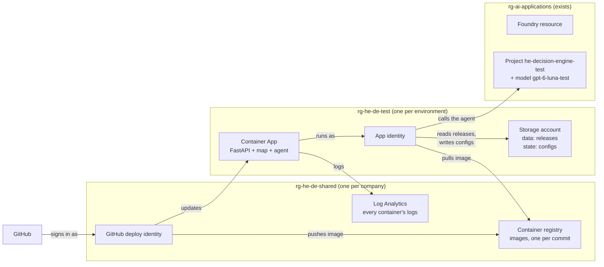

# Setting up the decision engine in the Azure portal

This guide builds the decision engine's test environment by hand in the Azure portal, then prod from a template. Each step says what you're creating, why the app needs it, where to click, and how to check it worked.

It's written for learning. Once test is built, the same setup exists as code in `infra/`, which is what a new client's instance will be built from.

## What you'll end up with

**Three ideas run through the whole guide:**

- **Resource groups are boundaries.** Everything in a resource group is created, permissioned and deleted together. Test and prod each get one, so deleting test can never touch prod. Shared pieces, the registry and logs, sit in their own group.
- **Nothing uses passwords.** The app signs in to storage, the registry and Foundry as a *managed identity*: an identity Azure creates and rotates for you. GitHub signs in the same way through a *federated credential*. There's no secret to leak or expire.
- **Each identity gets the least it needs.** The app can read data releases but not change them; it can write configs. You grant each permission as a *role assignment*: who, what role, on what.

## Rounds

| Round | Who | What | Time |
| --- | --- | --- | --- |
| 1 | You | Prerequisites: rights, quota, providers, GitHub environments, IT request | 1–2 hours, plus waiting on IT |
| 1 | Claude | App code for storage and releases, this guide's round 2, the templates, the pipeline | |
| 2 | You | Build test by hand | Half a day |
| 3 | You | Check the template against test, then build prod from it | 1–2 hours |

---

# Round 1: Prerequisites

None of these steps costs anything. Do step 2 first: a quota increase can take days.

## 1. Check your rights

**What:** confirm your role on the subscription.

**Why:** later steps create resources (needs Contributor) and grant roles to identities (needs the right to assign roles). Owner covers both. Contributor alone can create everything but can't grant roles, so step 11 of round 2 would fail.

**Click path:**
1. [Azure portal](https://portal.azure.com), search for **Subscriptions** and open the subscription the app runs in.
2. **Access control (IAM)**, then **View my access**.

**Check:** you see **Owner**, or both **Contributor** and **Role Based Access Control Administrator**. If not, ask whoever owns the subscription before going further.

## 2. Check model quota for the test deployment

**What:** confirm there's room for a second, small model deployment.

**Why:** test gets its own deployment, `gpt-6-luna-test`, so test traffic can't use up prod's rate limit. Quota is counted per subscription, per region, per model, in thousands of tokens per minute. Prod's `gpt-6-luna` already uses 125. Test needs 30 more.

**Click path:**
1. [Foundry portal](https://ai.azure.com), open the project `ai-applications-uk`.
2. Open **Quota**. It's under **Management center** in the left menu, or under **Operate** if your portal shows the newer layout.
3. Choose region **UK South** and find **gpt-6-luna**, Global Standard.

**Check:** the limit minus the usage is at least 30. If it isn't, request an increase on the same page (choose a new limit of at least 155) and carry on with the other steps while it's reviewed.

## 3. Register the resource providers

**What:** switch on the Azure services the app uses in your subscription.

**Why:** each Azure service is a *resource provider* that must be registered once per subscription before you can create its resources. A missing one fails partway through a later step with `MissingSubscriptionRegistration`. Registering is free.

**Click path:** your subscription, then **Settings**, **Resource providers**. Search for each one below, select it, and click **Register**:

| Provider | Needed for |
| --- | --- |
| `Microsoft.App` | Container Apps, which run the app |
| `Microsoft.ContainerRegistry` | The registry holding the app's images |
| `Microsoft.OperationalInsights` | Log Analytics, where logs go |
| `Microsoft.Storage` | The storage account for data releases and configs |
| `Microsoft.ManagedIdentity` | The identities the app and GitHub sign in as |
| `Microsoft.CognitiveServices` | Foundry, already registered since prod exists |

**Check:** each shows **Registered**. It takes a minute or two per provider.

## 4. Create the GitHub environments

**What:** two deployment environments in the GitHub repo, `test` and `prod`.

**Why:** the pipeline deploys every push to `main` to test automatically, then waits for your approval before prod. GitHub environments provide that approval gate. They also let Azure tell test deployments apart from prod ones: the GitHub identity in round 2 trusts each environment by name.

**Click path:** the repo on GitHub, **Settings**, **Environments**, **New environment**.

1. Name it `test`, then **Configure environment**.
   - Under **Deployment branches and tags**, choose **Selected branches and tags**, then **Add deployment branch or tag rule**, and enter `main`.
   - **Save protection rules**.
2. Create a second one named `prod`, with the same branch rule, and also:
   - Tick **Required reviewers** and add yourself.
   - **Save protection rules**.

**Check:** the Environments page lists `test` and `prod`, and `prod` shows "1 protection rule" or more.

## 5. Chase IT on sign-in

**What:** the Entra app registration that puts sign-in in front of the app, still pending from [DEPLOY.md](../DEPLOY.md) step 11.

**Why:** without sign-in, anyone with the URL can use the app and the model quota. Sign-in also tells the app *who* each user is, which is how it keeps each analyst's saved configs separate.

**Ask IT for three changes to the original request:**

> For the decision engine's app registration, please also:
> - **Add two app roles:** `Analyst` (value `Analyst`) and `Admin` (value `Admin`), both for users and groups. We'll ask you to assign people to them once the app is live.
> - **Add me as an owner** of the registration, so I can add redirect URIs for the new test and prod environments myself. If that's not possible, I'll send the two URIs once they exist.
> - **Keep it single tenant.**

**What the roles do:** an analyst sees only their own saved configs. An admin sees everyone's configs in that instance. The app reads the role from the sign-in token, so assigning people is done in Entra, by IT, not in our app.

## 6. Send three values to Claude

| Value | Where to find it |
| --- | --- |
| Your object ID | [Entra admin center](https://entra.microsoft.com), **Users**, **All users**, you, **Object ID** |
| Tenant ID | Entra admin center, **Overview**, **Tenant ID** |
| Office or VPN IP range | Your IT team, e.g. `203.0.113.0/24` |

The object ID gets you write access to data releases. The IP range restricts the test app to the office until sign-in is on.

---

# Round 2: Build test by hand

*Being written. It covers resource groups, Log Analytics, the registry, the storage account, the app identity and its roles, the Foundry project and model deployment, the Container App, the GitHub identity, the first data release, the documents and the first pipeline run.*

# Round 3: Prod from the template

*Being written. It covers checking the template against test, deploying prod, copying the data release, the redirect URI, the first approved prod deploy, and retiring the old resource group.*
